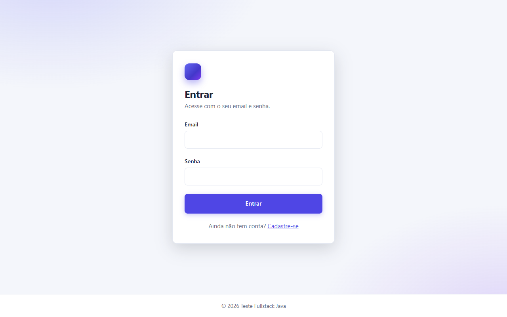
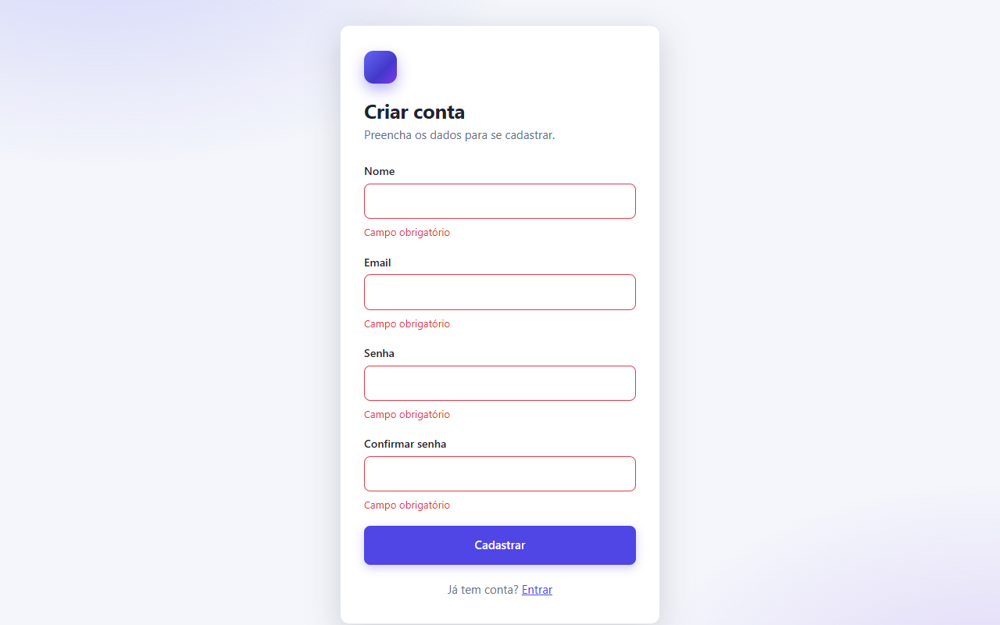
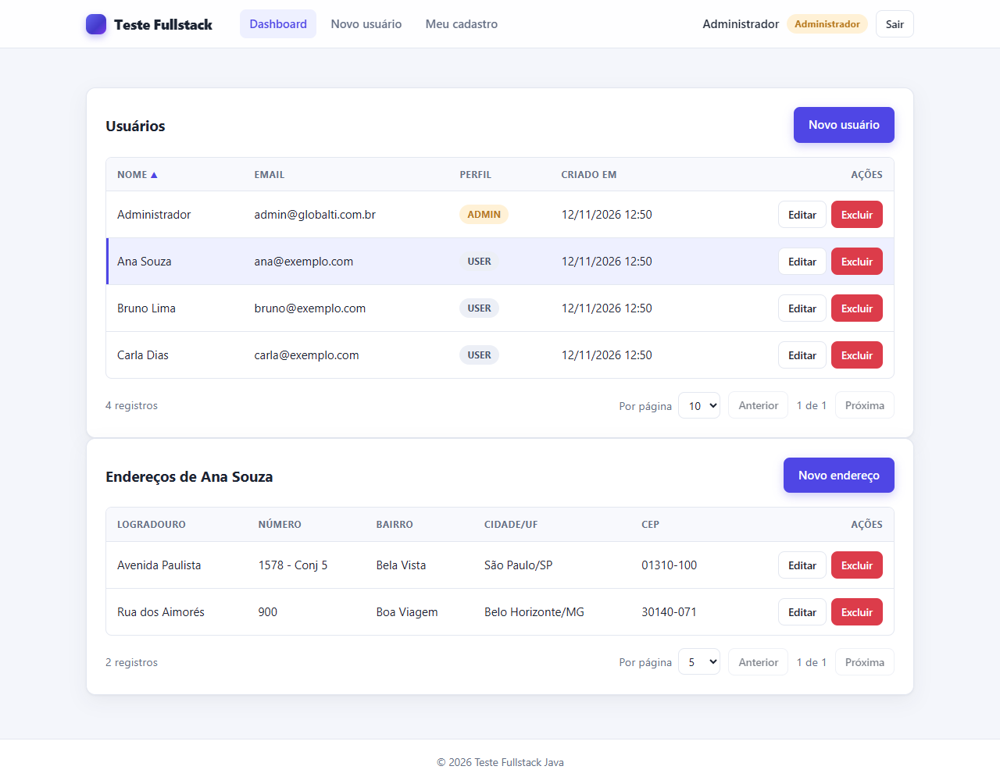
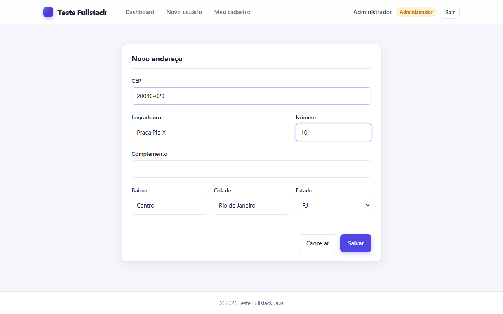
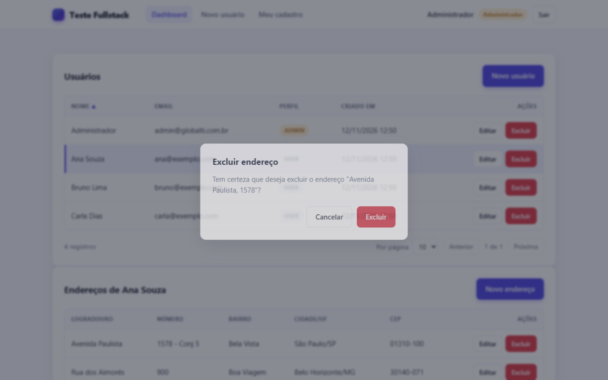
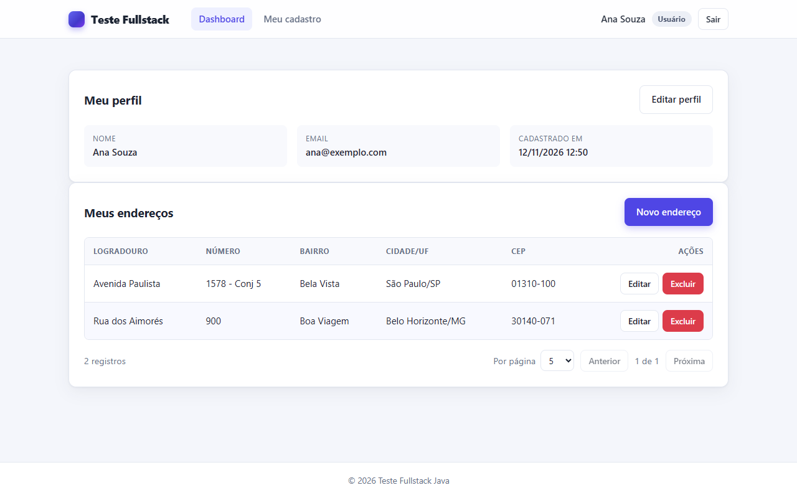
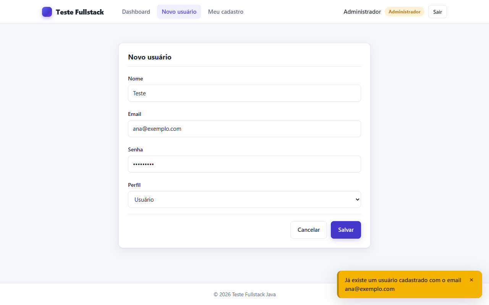
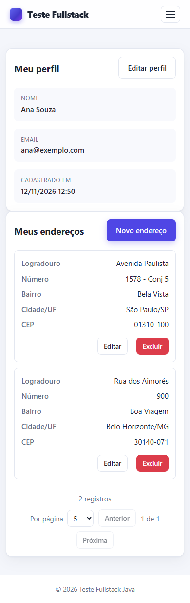
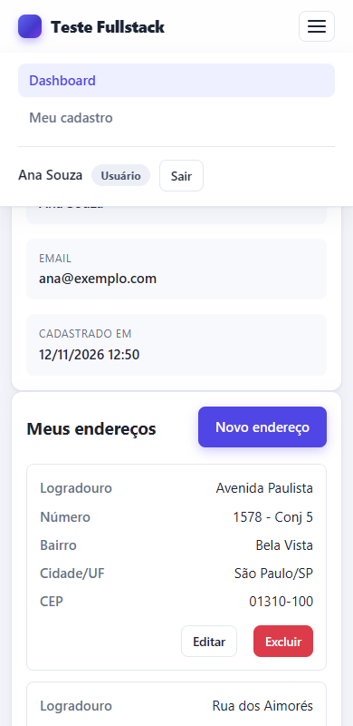

# Teste Fullstack Java

API REST de usuários e endereços (Spring Boot + JPA + PostgreSQL) com autenticação JWT e consulta de CEP no
ViaCEP, mais um frontend SPA em Angular que consome a API.

## O que o projeto faz

- CRUD de usuários e CRUD de endereços (um usuário tem vários endereços).
- Login e registro com JWT. Dois perfis: **ADMIN** (gerencia todos os usuários e endereços) e **USER**
  (só vê e altera os próprios dados; em dado de outra pessoa recebe 403).
- Ao cadastrar um endereço, o CEP é validado e consultado no ViaCEP; logradouro, bairro, cidade e estado são
  preenchidos automaticamente quando o cliente não envia.
- Listagens com paginação e ordenação (usuários: `nome`, `email`, `criadoEm`).
- Erros sempre em JSON padronizado, em português.
- Frontend com login, registro, dashboard, formulários, toasts, loaders e confirmação antes de excluir.

## Tecnologias

| Parte | Tecnologias |
|-------|-------------|
| Backend | Java 21, Spring Boot 3.5, Spring Data JPA, Spring Security, Bean Validation, Flyway, jjwt, springdoc-openapi (Swagger), Lombok |
| Banco | PostgreSQL 16 (Docker) |
| Testes | JUnit 5, Mockito, Spring Boot Test, Testcontainers (PostgreSQL real) |
| Frontend | Angular 22 (componentes standalone, formulários reativos, signals), CSS próprio |

## Telas

### Login e registro

| Login | Registro com validação por campo |
|-------|----------------------------------|
|  |  |

### Dashboard do administrador

O ADMIN vê todos os usuários (paginados e ordenáveis por nome, email e data de criação). Ao clicar em um usuário,
os endereços dele aparecem logo abaixo.



### Cadastro de endereço com CEP e confirmação de exclusão

Ao digitar o CEP, a API consulta o ViaCEP e preenche logradouro, bairro, cidade e estado.

| Formulário de endereço | Confirmação antes de excluir |
|------------------------|------------------------------|
|  |  |

### Usuário comum e toast de alerta

O USER vê só o próprio perfil e os próprios endereços. Avisos (como email já cadastrado) aparecem em toasts.

| Dashboard do usuário | Toast de alerta |
|----------------------|-----------------|
|  |  |

### Responsivo

| Dashboard no celular | Menu no celular |
|----------------------|-----------------|
|  |  |

## Estrutura

```
├── backend/     API (Maven)
│   └── src/main/java/br/com/globalti/prova/
│       ├── config/      SecurityConfig, OpenApiConfig, RestClientConfig, paginação, admin inicial
│       ├── security/    JwtService, JwtAuthFilter, UserDetailsServiceImpl
│       ├── controller/  só recebem e respondem HTTP
│       ├── service/     regras de negócio e de permissão
│       ├── repository/  acesso ao banco
│       ├── domain/      entidades (User, Address, Role)
│       ├── dto/         request/ e response/
│       ├── mapper/      conversão entidade <-> DTO
│       ├── client/      cliente do ViaCEP
│       └── exception/   exceções de negócio e GlobalExceptionHandler
├── frontend/    SPA Angular
│   └── src/app/
│       ├── core/        guards, interceptors (auth, loader, erro) e services de API
│       ├── shared/      toast, loader, confirmação, paginação e outros componentes reutilizáveis
│       ├── features/    auth, dashboard, users, addresses
│       └── models/      interfaces TypeScript
├── docker-compose.yml   PostgreSQL
└── .env.example         modelo das variáveis de ambiente
```

## Pré-requisitos

- Java 21
- Maven 3.9+
- Node.js 22.22+ ou 24.15+ (exigência do Angular 22) e npm
- Docker (para o banco e para os testes de integração)

## Como rodar

### 1. Variáveis de ambiente

```bash
cp .env.example .env
```

Edite o `.env` e troque `DB_PASSWORD` e `JWT_SECRET` (mínimo de 32 caracteres). O arquivo `.env` não vai para o Git.

| Variável | Para que serve | Padrão |
|----------|----------------|--------|
| `DB_NAME`, `DB_USER`, `DB_PASSWORD` | Banco de dados | `prova`, `prova`, sem padrão |
| `DB_PORT` | Porta do PostgreSQL na sua máquina | `5432` |
| `JWT_SECRET` | Segredo que assina o token (mín. 32 caracteres) | sem padrão: a API não sobe sem ele |
| `JWT_EXPIRATION_MINUTES` | Validade do token | `120` |
| `ADMIN_EMAIL`, `ADMIN_PASSWORD` | Admin criado na primeira execução | veja abaixo |
| `CORS_ALLOWED_ORIGINS` | Origens liberadas no CORS | `http://localhost:4200` |

> Se a porta 5432 já estiver em uso (outro Postgres rodando), mude `DB_PORT` no `.env`, por exemplo para `5433`.

### 2. Banco de dados

```bash
docker compose up -d
```

As tabelas são criadas pelo Flyway quando a API sobe.

### 3. API

```bash
cd backend
mvn spring-boot:run
```

A API fica em http://localhost:8080 e lê as variáveis do `.env` da raiz do projeto (ou do ambiente, se estiverem
definidas lá).

- Swagger: http://localhost:8080/swagger-ui.html
- Para testar rotas protegidas no Swagger: faça login em `POST /api/auth/login`, clique em **Authorize** e cole o token.

### 4. Frontend

```bash
cd frontend
npm install
npm start
```

Abra http://localhost:4200. Em desenvolvimento, o Angular repassa as chamadas `/api` para
`http://localhost:8080` (arquivo `frontend/proxy.conf.json`), então a API precisa estar rodando.

### 5. Testes

```bash
cd backend
mvn test        # ou: mvn verify
```

O Docker precisa estar aberto: os testes de repositório e de integração sobem um PostgreSQL de verdade com
Testcontainers. **O ViaCEP é mockado em todos os testes, nenhum chama a internet.**

Para conferir o build do frontend: `cd frontend && npm run build`.

## Usuário ADMIN de exemplo

Na primeira vez que a API sobe, ela cria um administrador (se ele ainda não existir):

| Email | Senha |
|-------|-------|
| `admin@globalti.com.br` | `Admin@123` |

É um usuário de demonstração. Para mudar, defina `ADMIN_EMAIL` e `ADMIN_PASSWORD` no `.env` antes da primeira execução.
Em qualquer ambiente real, troque essa senha.

## Endpoints

Todas as rotas, exceto `/api/auth/**`, exigem o cabeçalho `Authorization: Bearer <token>`.

| Método | Rota | Quem acessa | Descrição |
|--------|------|-------------|-----------|
| POST | `/api/auth/register` | público | Cria usuário comum (USER) e devolve o token |
| POST | `/api/auth/login` | público | Devolve o token |
| GET | `/api/users` | ADMIN | Lista paginada (`page`, `size`, `sort=nome,asc`) |
| POST | `/api/users` | ADMIN | Cria usuário escolhendo o perfil |
| GET | `/api/users/me` | logado | Dados do usuário do token |
| GET | `/api/users/{id}` | ADMIN ou o próprio | Busca um usuário |
| PUT | `/api/users/{id}` | ADMIN ou o próprio | Edita (senha opcional; só ADMIN altera o perfil) |
| DELETE | `/api/users/{id}` | ADMIN ou o próprio | Exclui o usuário e os endereços dele |
| GET | `/api/users/{userId}/addresses` | ADMIN ou o dono | Lista paginada (ordena por `id`, `cidade`, `cep`, `logradouro`) |
| POST | `/api/users/{userId}/addresses` | ADMIN ou o dono | Cadastra endereço (valida CEP e completa pelo ViaCEP) |
| GET | `/api/addresses/{id}` | ADMIN ou o dono | Busca um endereço |
| PUT | `/api/addresses/{id}` | ADMIN ou o dono | Edita um endereço |
| DELETE | `/api/addresses/{id}` | ADMIN ou o dono | Exclui um endereço |
| GET | `/api/cep/{cep}` | logado | Consulta um CEP (com ou sem hífen) |

Códigos de erro: `400` validação, CEP inválido/inexistente ou ordenação por campo não permitido; `401` sem token,
token inválido ou login errado; `403` sem permissão; `404` não encontrado; `409` email já cadastrado;
`503` ViaCEP indisponível; `500` erro inesperado (sem detalhes internos na resposta). Formato:

```json
{
  "timestamp": "2026-11-12T12:29:42",
  "status": 400,
  "erro": "Bad Request",
  "mensagem": "Existem campos inválidos na requisição",
  "caminho": "/api/auth/register",
  "campos": [{ "campo": "email", "mensagem": "Email inválido" }]
}
```

## Decisões que tomei

- **JWT sem estado.** O token leva só o id do usuário. A cada requisição o filtro busca o usuário no banco,
  então se um admin muda o perfil ou apaga um usuário, o token antigo deixa de valer na hora. O segredo e a validade
  vêm do ambiente; a API se recusa a subir com segredo curto.
- **Registro público só cria USER.** O DTO de registro nem tem o campo `role`; mesmo que alguém envie `"role": "ADMIN"`,
  ele é ignorado. Só um ADMIN cria outro ADMIN. Na edição, o `role` só é considerado se quem edita for ADMIN.
- **Regra de permissão no service.** Os controllers só recebem e respondem HTTP. Quem decide "quem pode mexer em quê" é
  o service, em um único ponto por classe, o que também deixa tudo testável sem subir o Spring.
- **DTOs em vez de entidades.** Nenhuma entidade JPA sai na API, então a senha (hash) nunca aparece em resposta. Os
  mappers são escritos à mão para ficar claro quais campos são expostos.
- **CEP normalizado.** Aceito `01310-100` ou `01310100` e guardo sempre os 8 dígitos. O ViaCEP é consultado em todo
  cadastro/edição de endereço, então um CEP que não existe nunca entra no banco. Valores enviados pelo cliente têm
  prioridade sobre os do ViaCEP. Se o ViaCEP cair ou demorar (timeouts de 3 s e 5 s), a API responde 503, nunca 500.
- **Ordenação com lista fechada.** Só são aceitos os campos permitidos; qualquer outro devolve 400 (se passasse direto
  para o JPA, viraria um 500).
- **ViaCEP mockado nos testes.** Os testes não dependem de internet nem do ViaCEP estar no ar. O cliente HTTP tem testes
  próprios com um servidor falso, cobrindo CEP inexistente, 4xx, 5xx e resposta ilegível.
- **Admin inicial criado na subida da API**, e não por migration, para o hash da senha ser gerado na hora e não ficar
  escrito no repositório.
- **Token no `localStorage` do navegador.** É simples e adequado para este escopo; em produção eu avaliaria cookie
  `HttpOnly` para reduzir o impacto de um ataque XSS.
- **CSS próprio no frontend**, sem biblioteca de componentes, para manter o projeto leve.
